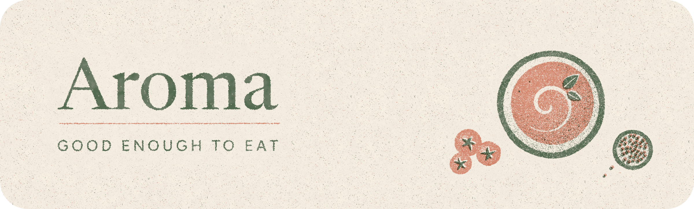

<picture>
  <source media="(prefers-color-scheme: dark)" srcset="docs/assets/hero-dark-2.png">
  
</picture>

Aroma is an Android app for Mealie, available in English and German. It came from needing a recipe app that's nice to look at and that the household enjoys enough to actually use.

<picture>
  <source media="(prefers-color-scheme: dark)" srcset="docs/assets/aroma-screens-dark-2.webp">
  
</picture>

 

<b>What it does</b>

 

- Pleasant UI, designed like a cookbook
- Features made for everyday cooking
- Care for the little details (like widgets)

<b>Features</b>

 

- Recipes laid out like a cookbook page, with the times at a glance and the amounts in their own column
- Servings that scale every amount, including the ones written in the steps
- Measures as written, metric or US, down to oven temperatures and pan sizes in the steps
- Cooking mode with one step at a time, the ingredients it uses, timers from the times in the text and the screen kept on
- Ingredients ticked off with a tap where a step names them
- A meal plan for the week, whose ingredients go on the shopping list in one go
- A shopping list that works offline, and a shopping mode with large text for the supermarket
- Widgets for today's meal and the shopping list, and shortcuts on the app icon
- Imports from websites, from Instagram, TikTok and Facebook posts and from photos, with Mealie's AI where it helps

The little details are things like these: a cup of flour becomes 120 g and a cup of sugar 198 g, amounts read ½ rather than 0.5, "1:20 h" in a step starts a timer of an hour and twenty minutes, and a link shared to Aroma leaves its tracking behind.

<b>Requirements</b>

 

Android 8.0 or newer and Mealie 2.0 or newer. AI imports need Mealie 3.23 or newer and a configured AI provider. A server with a certificate from your own authority works once that authority is installed on the phone.

<b>Installation</b>

 

Download the APK from the [latest release](https://github.com/hazymorning/Aroma/releases/latest) and open it; Android asks once whether your browser may install apps. Then sign in with your Mealie address and account, or with an API token.

Later versions come through the settings, where Aroma looks for them on GitHub when you ask, or at every start if you like.

<b>Privacy</b>

 

Aroma connects only to the configured Mealie server. There are two exceptions: importing a social media post reads its preview from the platform, and the update check asks GitHub for the latest release, when started manually or, if switched on, at app start. No analytics, no ads, no tracking.

<b>Security</b>

 

Aroma was made in Germany, which may explain the following.

Your password is only used to sign in. After that Aroma works with a token of its own, named after the phone, encrypted with a key that never leaves it and kept out of backups. The token only ever goes to your Mealie server. Connections use https, and plain http only for addresses in your home network or when you type it yourself, and never quietly.

Photos are uploaded without their location. Signing out removes everything the account left on the phone and revokes the token as soon as Mealie can be reached. Updates install only when they carry the same signature as the app you have.

