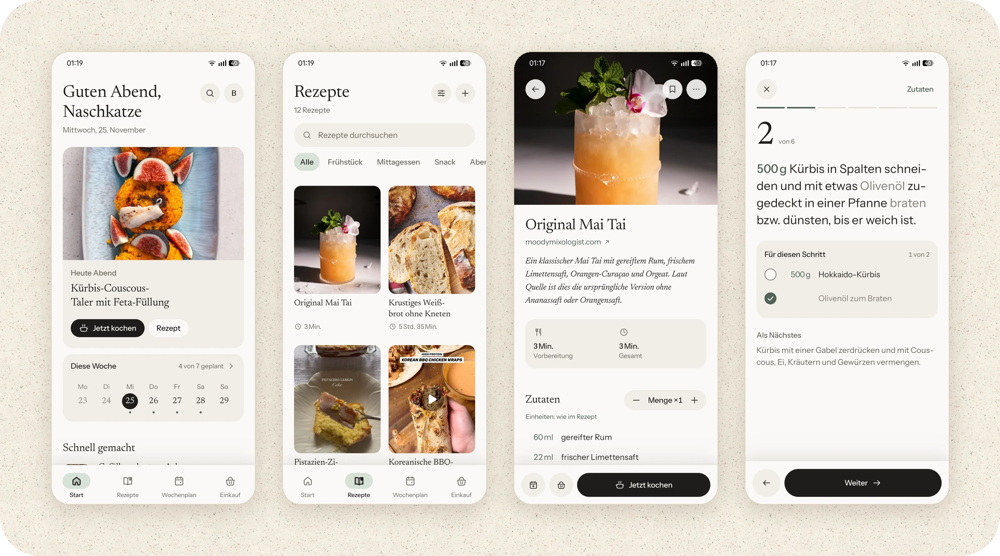

<picture>
  <source media="(prefers-color-scheme: dark)" srcset="docs/assets/hero-dark-2.png">
  
</picture>

 
 

Aroma is an Android app for Mealie, available in English and German. It's designed like a cookbook and builds on years of using other recipe apps.

 

<picture>
  <source media="(prefers-color-scheme: dark)" srcset="docs/assets/aroma-screens-dark-2.webp">
  
</picture>

 
 

<b>Features</b>

 

- Home shows what's planned and ideas that suit the time of day
- Cooking mode goes one step at a time in large type and shows what each step needs
- Timers start from a step and ring even when the screen is off
- Shopping mode keeps every row in place while you tick things off
- Amounts in metric or US units, however the recipe was written
- Recipes from social media posts through the share menu
- Widgets for the meal plan and the shopping list
- Recipes, the meal plan and the shopping list also work offline

<b>Requirements</b>

 

Android 8.0 or newer and Mealie 2.0 or newer. AI imports need Mealie 3.23 or newer and a configured AI provider.

<b>Installation</b>

 

Download the APK from the [latest release](https://github.com/hazymorning/Aroma/releases/latest) and install it. Then sign in with your Mealie address and your account or an API token. Updates can be installed from the settings.

<b>Privacy</b>

 

Aroma connects only to the configured Mealie server. There are two exceptions: importing a social media post reads its preview from the platform, and the update check asks GitHub for the latest release, when started manually or, if switched on, at app start. No analytics, no ads, no tracking.

<b>Security</b>

 

Your password is only used for signing in. Aroma keeps the login encrypted on the phone and only sends it to your Mealie server. Signing out removes your data from the phone, and only official Aroma updates can be installed.

<b>Feedback</b>

 

Questions and ideas are welcome in the [Discussions](https://github.com/hazymorning/Aroma/discussions).

<b>License</b>

 

Aroma is free and open source (GPL-3.0).

