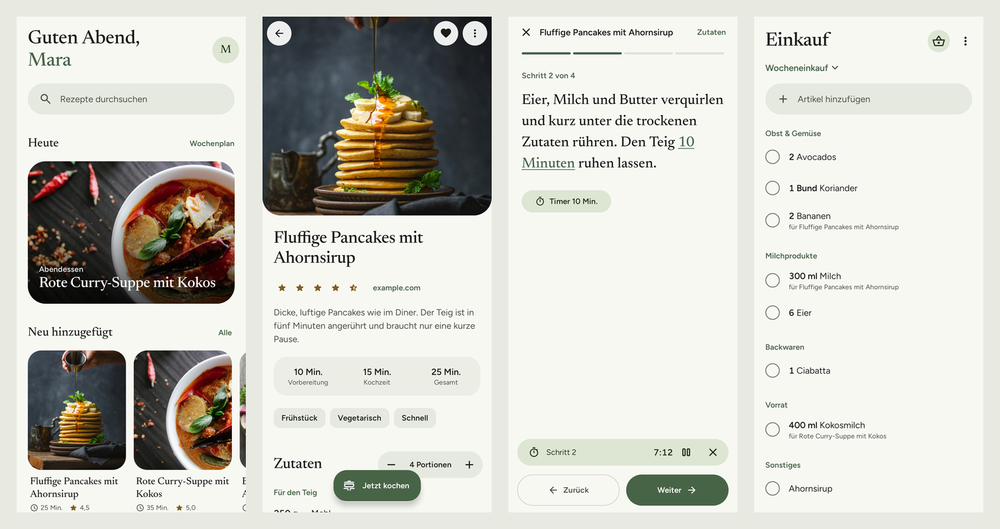
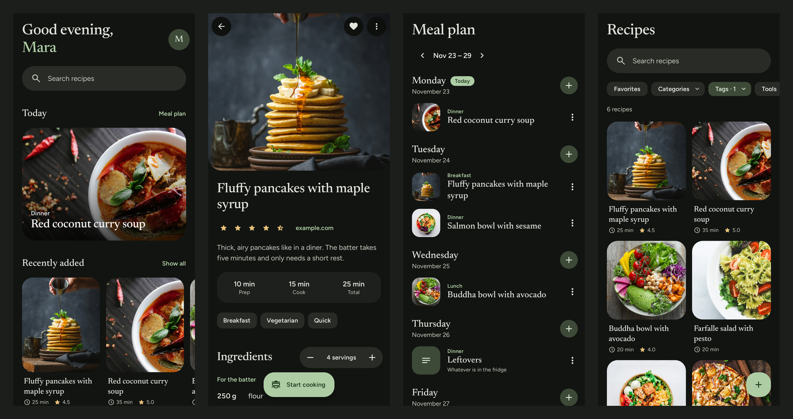

# Kochi

Ein ruhiger Android-Client für [Mealie](https://mealie.io), die selbst gehostete Rezeptverwaltung.
Kochi zeigt deine Rezepte, deinen Wochenplan und deine Einkaufslisten so, dass man sie in der Küche gern benutzt.




## Was Kochi kann

- **Rezepte** durchsuchen, nach Favoriten, Kategorien, Schlagwörtern und Utensilien filtern, sortieren, Kochbücher öffnen
- **Rezeptansicht** mit umrechenbaren Portionen (auch bei Zutaten, die Mealie nur als Text kennt), echten Brüchen, abhakbaren Zutaten, Notizen und Nährwerten
- **Kochmodus** mit großer Schrift, einem Schritt pro Seite und Timern, die Kochi aus dem Text erkennt („10 Minuten ruhen lassen“); der Bildschirm bleibt an
- **Wochenplan** für die nächsten sieben Tage, mit Rezepten oder freien Einträgen; Zutaten lassen sich direkt auf die Einkaufsliste setzen
- **Einkaufslisten** nach den Labels aus Mealie gruppiert, mit Abhaken, Wischen zum Löschen (rückgängig machbar) und einem Einkaufsmodus mit großer Schrift
- **Offline**: geöffnete Rezepte bleiben verfügbar, auf Wunsch alle; Änderungen an Einkaufslisten werden übertragen, sobald wieder Netz da ist
- **Rezepte hinzufügen** per Link oder direkt über „Teilen“ im Browser, selbst anlegen und bearbeiten
- Hell, dunkel oder Material You, auf Deutsch und Englisch

## Voraussetzungen

- Android 8.0 oder neuer
- Mealie 2.0 oder neuer (geprüft mit 2.0.0, 2.8.0 und 3.31.0)

## Installation

Die APK gibt es unter [Releases](https://github.com/hazymorning/Mealie-Client/releases). Herunterladen,
öffnen und die Installation erlauben; Android fragt beim ersten Mal, ob der Browser oder Dateimanager
Apps installieren darf. Neuere Versionen werden einfach darüber installiert, deine Anmeldung bleibt erhalten.
Was sich geändert hat, steht im [Changelog](CHANGELOG.md).

Alle Release-APKs sind mit diesem Zertifikat signiert (SHA-256):

```
F0:6F:0F:44:A3:15:B8:82:63:29:86:F6:62:55:00:E0:A4:24:AB:A8:9C:E4:96:35:83:FD:29:F6:BF:CD:A8:F4
```

## Anmeldung

Gib die Adresse ein, unter der du Mealie im Browser öffnest; `https://` kann weggelassen werden.
Danach meldest du dich mit Benutzername und Passwort an. Kochi legt dabei in deinem Mealie-Profil ein
API-Token namens „Kochi (Gerätename)“ an, damit die Anmeldung nicht nach Ablauf der Sitzung endet.
Beim Abmelden wird es wieder gelöscht. LDAP-Konten melden sich genauso an. Wer Mealie nur über
OpenID Connect (SSO) nutzt, verwendet stattdessen ein selbst erstelltes API-Token.

Das Token wird mit einem Schlüssel aus dem Android Keystore verschlüsselt gespeichert und nur an den
eigenen Mealie-Server gesendet. Für Server im Heimnetz funktionieren auch `http://` und eigene
Zertifikate, sofern diese auf dem Gerät installiert sind.

## Bauen

Benötigt JDK 21 und das Android SDK.

```sh
./gradlew assembleDebug
```

Die APK liegt danach unter `app/build/outputs/apk/debug/`.

Für eine signierte Release-Version `KOCHI_KEYSTORE` (Pfad zum Keystore) und `KOCHI_KEYSTORE_PASSWORD`
setzen und `./gradlew assembleRelease` ausführen. Alias und Schlüsselpasswort lassen sich mit
`KOCHI_KEY_ALIAS` (Standard `kochi`) und `KOCHI_KEY_PASSWORD` (Standard: das Keystore-Passwort) ändern.

## Tests und Qualität

```sh
./gradlew spotlessCheck lintDebug testDebugUnitTest
```

- Unit-Tests für Mengen, Zutaten, Zeiterkennung, Markdown, Server-Adressen und die Offline-Synchronisation
- Screenshot-Tests aller Bildschirme in Hell und Dunkel, auf Deutsch und Englisch:
  `./gradlew recordRoborazziDebug` legt sie unter `app/build/outputs/roborazzi` ab
- Tests gegen einen echten Mealie-Server. Sie legen eigene Testdaten an und entfernen sie wieder:

  ```sh
  MEALIE_TEST_URL=http://localhost:9000 MEALIE_TEST_USER=changeme@example.com \
  MEALIE_TEST_PASSWORD=MyPassword ./gradlew testDebugUnitTest
  ```

Die CI führt alles davon aus, die API-Tests gegen einen Mealie-Container.

## Aufbau

| Paket | Inhalt |
| --- | --- |
| `core` | Modelle und Formatierung von Mengen, Zutaten, Zeiten und Markdown, ohne Android-Abhängigkeiten |
| `data` | Mealie-API (Retrofit), verschlüsselte Sitzung, Room-Cache und Warteschlange für Offline-Änderungen |
| `feature` | Bildschirme mit ihren ViewModels |
| `ui` | Theme, gemeinsame Bausteine und Navigation |

## Credits

Schriften: [Newsreader](https://github.com/productiontype/Newsreader) und [Figtree](https://github.com/erikdkennedy/figtree)
(SIL Open Font License 1.1). Icons: [Material Symbols](https://fonts.google.com/icons) (Apache License 2.0).
Die Fotos in den Screenshots stammen von [Unsplash](https://unsplash.com).

---

## English

Kochi is a calm Android client for [Mealie](https://mealie.io), the self-hosted recipe manager.
It covers recipes with search, filters and cookbooks, scalable ingredients with proper fractions,
a cooking mode with timers detected in the instructions, a seven-day meal plan, shopping lists
grouped by Mealie labels with a large-text shopping mode, offline access with queued shopping list
changes, and importing recipes from a link or the Android share sheet. It runs on Android 8.0 and
newer and works with Mealie 2.0 and newer. The app is available in English and German.
Download the APK from [Releases](https://github.com/hazymorning/Mealie-Client/releases); release builds
are signed with the certificate listed above.

Sign in with your server address and Mealie username and password. Kochi then creates an API token
named "Kochi (device name)" so you stay signed in, and deletes it again when you sign out. LDAP
accounts sign in the same way; if you only use OpenID Connect (SSO), use an API token you created
yourself instead.

Build with JDK 21 and `./gradlew assembleDebug`; run checks with `./gradlew spotlessCheck lintDebug testDebugUnitTest`.
