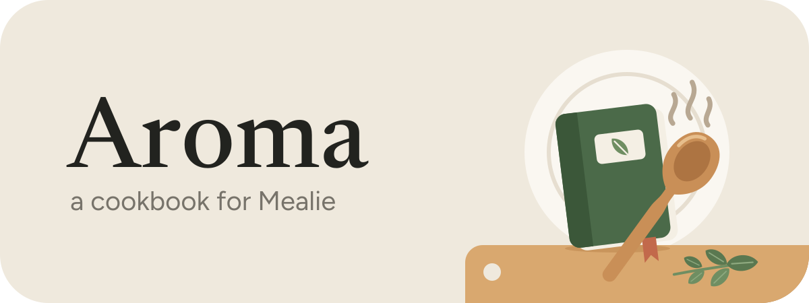

<picture>
  <source media="(prefers-color-scheme: dark)" srcset="docs/readme/header-dark.svg">
  
</picture>

 
 

Aroma is a recipe app for Mealie, made for Android. It comes in light and dark, and in English and German.

 

**The ideas behind it:**

- Calm design that reads like a cookbook
- Recipes from any link, post or text in one tap
- Cooking, planning and shopping that work in the kitchen, even offline

 

<b>Requirements</b>

 

Android 8.0 or newer and a Mealie server, version 2.0 or newer. Importing with AI needs Mealie 3.23 or newer with an AI provider set up.

<b>Privacy</b>

 

Aroma talks to your Mealie server and nothing else, with two exceptions you start yourself: importing a social media post reads its preview from the platform, the way a messenger does when you share a link, and looking for updates asks GitHub for the latest release. Aroma collects no data and has no ads or trackers.

